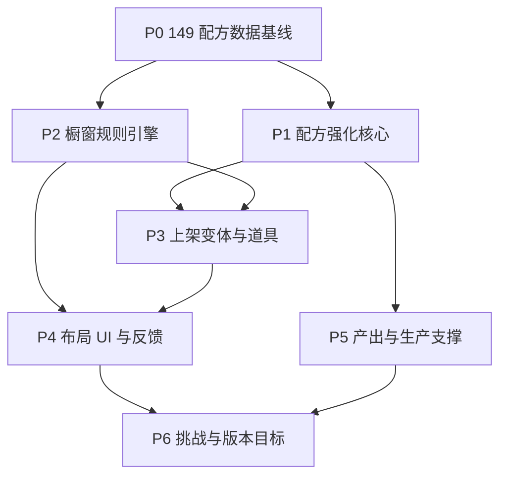

# 后 MVP 橱窗构筑与配方强化任务计划

> **状态更新（2026-07-15）：** 本计划中的任务路线已收口到[橱窗构筑任务路线重设计](../docs/superpowers/specs/2026-07-15-showcase-build-task-route-redesign.zh.md)。当前实现不再使用“后 MVP 终章任务”或规则文件中的独立挑战模板；Lv.3–Lv.5 使用构筑评鉴，Lv.6+ 使用 `game_data.json.tasks.round_contracts` 中的铜/银/金经营合同。本文仍作为配方强化与橱窗规则的历史设计背景。

> **配方成长更新（2026-07-15）：** 当前基线已为 166 道配方。现行长线培养保留标签/形状候选特性与橱窗正向邻接成长，并按[设备五级与配方名作成长设计](../docs/superpowers/specs/2026-07-15-device-recipe-masterwork-growth-design.zh.md)增加五台成品设备固定五级和招牌后的名作 Lv.1—Lv.10。本历史计划中的 149 配方表述不再作为当前数量契约。

生成日期：2026-07-09

> **For agentic workers:** REQUIRED SUB-SKILL: Use `superpowers:subagent-driven-development` or `superpowers:executing-plans` to implement this plan task-by-task. Steps use checkbox (`- [ ]`) syntax for tracking.

**目标：** 在当前已经拥有 149 个配方的基础上，后续版本不再以“继续堆配方数量”或“强化顾客关系”为主，而是把重点转向配方强化、橱窗布局、上架商品之间的增益/减损，以及玩家围绕橱窗 build 做长期优化。

**核心方向：** 弱化顾客。顾客仍用于营业结算、需求反馈和验证橱窗选择，但不作为后续主成长系统；不优先做常客姓名、来访记录、NPC 好感或客群专属路线。后 MVP 的主线应是“149 配方如何被分类、强化、变体化、摆放、组合、克制和结算解释”。

**架构原则：** 149 配方是内容基线，后续开发先治理数据、标签、形状、链路和规则，再扩展玩法。长期状态进入 `GameState`；配方成长放在 `RecipeGrowthService`；橱窗增益/减损计算放在 `ShopSimulation` 或独立展示规则服务；UI 只负责展示来源、提示原因和收集玩家选择。

**技术栈：** Godot 4.6.1、GDScript、`Catalog`、`GameState`、`RecipeGrowthService`、`RecipeBook`、`ShopSimulation`、`ProductionSite`、`main_view.gd`、`Main.tscn`、`doc/recipe_display_config.json`、`doc/display_rules_full.json`、`tests/mvp_self_check.gd`。

## 全局约束

- 当前配方基线是 149 个；文档和计划不得再写“从 18 个扩展到 60+”作为目标。
- 顾客系统弱化为结算输入：只保留顾客类型、预算、偏好权重和反馈，不优先做常客、来访记录、NPC 好感、角色剧情。
- 配方研发与收集是内容基础，后续重点是配方强化和橱窗构筑，不让单个顾客路线支配成长。
- 橱窗收益必须可解释：每次售价、售速、口碑或销量变化都应能拆分为配方成长、变体、位置、相邻、套装、主题、道具、冲突或事件来源。
- 增益与减损并重：不能只做正向加成；同类堆叠、口味冲突、饱腹压制、位置不适配、主题不匹配都应成为布局成本。
- 新增系统必须同步存档、旧档清洗、任务/图鉴文案和自检。
- ProjectRest 页面和布局改动优先编辑 `.tscn`，脚本只做节点绑定、行为和数据格式化。
- Godot headless 验证必须从 `D:\Project\ProjectRest\project-rest` 运行，并带 `--log-file "$env:TEMP\godot-headless.log"`。
- 不自动提交，除非用户明确要求。

---

## 1. 当前基线与重心调整

### 1.1 已有基础

- 149 个配方已经存在，下一步不是补数量，而是让这些配方在橱窗里有明确差异。
- 现有橱窗已经具备自由摆放、形状、旋转、区域、相邻、套装、冲突、倒计时和售卖反馈基础。
- `recipe_growth` 已经能记录制作、售卖、相邻触发，并支持试作品、稳定款、人气款、招牌款。
- `display_rules_full.json` 和 `recipe_display_config.json` 已经适合作为橱窗规则与配方展示配置的主数据源。

### 1.2 要降级的方向

以下内容不是删除，而是后置：

- 常客姓名、来访记录和专属偏好。
- NPC 剧情、送礼、好感、专属角色线。
- 顾客偏好路线中“卖给某类顾客后获得客群特性”的成长主线。
- 大型自由装修系统。
- 用季节、事件或剧情强行替代橱窗构筑。

顾客仍保留三个作用：

- 验证橱窗是否覆盖了不同需求。
- 给营业结果提供可读反馈。
- 作为平衡测试的需求样本，而不是玩家主要培养对象。

### 1.3 要强化的方向

- 配方分类：149 配方按形状、标签、价格段、售速、材料链、口味冲突和套装归类。
- 配方强化：每个配方能通过制作、售卖、橱窗触发成长，并获得可选择特性。
- 橱窗布局：位置、相邻、连通、区域、方向、主题、道具共同决定收益。
- 上架产品策略：同一配方可通过小份、标准、礼盒、大份等变体适配不同格局。
- 增益/减损解释：玩家能看懂为什么某个摆法更好或更差。

---

## 2. 推荐总顺序

| 阶段 | 主题 | 目的 |
| --- | --- | --- |
| P0 | 149 配方数据基线治理 | 确认所有配方能被橱窗、成长、图鉴和结算稳定读取 |
| P1 | 配方强化核心 | 把成长从“计数加成”扩展为可选择的配方特性 |
| P2 | 橱窗增益/减损规则引擎 | 建立可解释、可组合、可测试的展示规则层 |
| P3 | 上架变体与陈列道具 | 让同一配方在不同格局中有不同用途 |
| P4 | 橱窗布局 UI 与反馈 | 给玩家足够的信息做 build，而不是盲摆 |
| P5 | 产出/生产作为配方强化支撑 | 只补支撑橱窗策略的产出和生产资源压力 |
| P6 | 平衡、挑战与版本化目标 | 用挑战和评分推动重复游玩，不扩大顾客系统 |

---

## P0：149 配方数据基线治理

**目标：** 先把 149 配方整理为可长期维护的数据资产。所有配方必须有合法材料、设备、标签、形状、图鉴信息、橱窗占格和结算规则入口。

**文件：**

- Modify: `scripts/catalog.gd`
- Modify: `doc/recipe_display_config.json`
- Modify: `doc/display_rules_full.json`
- Modify: `tools/generate_recipe_icon_prompts.py`
- Modify: `tests/mvp_self_check.gd`
- Modify: `tests/test_generate_recipe_icon_prompts.py`

**任务：**

- [x] 增加 149 配方数量断言，确认 `Catalog.RECIPES`、展示配置和图标提示词覆盖同一批 ID。（完成：已补齐 `rich_rice_drink`、`white_sugar_rice_porridge` 运行时配方；`tests/mvp_self_check.gd` 断言 149，`doc/recipe_data_audit.md` 显示 catalog/display 均为 149 且无 display-only/missing-display ID。）
- [x] 校验每个配方的材料都存在于食材或可作为中间成品的配方中。（完成：`doc/recipe_data_audit.md` 当前未发现 unknown materials。）
- [x] 校验每个配方都有 `tags`、`price`、`output_count`、`unlock_level`、`device` 和展示形状。（完成：`doc/recipe_data_audit.md` 当前未发现 catalog/display 必填字段缺失。）
- [ ] 校验每个标签至少被一个规则、顾客偏好或图鉴说明识别，避免出现无效标签。（未完成：已生成标签覆盖清单，但当前仍有 44 个标签未被展示规则识别；需要后续补规则、顾客偏好或图鉴说明后才能关闭。）
- [x] 按配方用途生成分组：走量款、利润款、套装核心、相邻辅助、冲突风险、变体候选。（完成：`doc/recipe_data_audit.md` 已输出 6 类分组，当前分别为 25 / 18 / 112 / 116 / 43 / 149。）
- [x] 输出一份数据稽核报告到 `doc/`，列出缺图标、缺形状、缺规则、标签孤岛和材料孤岛。（完成：已生成 `doc/recipe_data_audit.md`。）

**验收：**

- 自检能确认当前配方总数为 149。
- 任意配方都能进入图鉴、制作、橱窗配置检查和营业模拟。
- 数据错误能定位到具体配方 ID 和字段。

---

## P1：配方强化核心

**目标：** 把配方成长从轻量计数升级为后 MVP 的主要长期目标。玩家反复制作、售卖、摆放某道配方后，应获得影响橱窗 build 的强化选择，而不是只获得固定售价加成。

**文件：**

- Modify: `scripts/recipe_growth_service.gd`
- Modify: `scripts/game_state.gd`
- Modify: `scripts/recipe_book.gd`
- Modify: `scripts/shop_simulation.gd`
- Modify: `scripts/main_view.gd`
- Modify: `tests/mvp_self_check.gd`

**核心模型：**

```json
{
  "recipe_growth": {
    "butter_cookie": {
      "mastery_level": 3,
      "made_count": 42,
      "sold_count": 31,
      "adjacency_trigger_count": 14,
      "available_traits": ["tea_partner", "gift_box_shape"],
      "selected_traits": ["tea_partner"],
      "pending_trait_choice": false
    }
  }
}
```

**任务：**

- [ ] 保留现有试作品、稳定款、人气款、招牌款四阶段，但重写奖励重点：稳定款偏制作效率，人气款偏相邻收益，招牌款偏变体或套装核心。（部分完成：四阶段仍保留，人气款/招牌款已改成候选特性和手动选择；稳定款制作效率、招牌款变体/套装核心奖励仍未完整接入。）
- [x] 为 149 配方自动生成候选特性，不手写 149 棵成长树。输入来源为标签、形状、售价段、设备、材料链和现有展示规则。（已完成第一版：`RecipeGrowthService` 基于配方标签、展示形状和通用特性生成候选池。）
- [x] 人气款升级时给 2 个候选特性，玩家选 1 个；招牌款升级时再给 2 个候选特性，玩家选 1 个。（已完成运行时第一版：`select_recipe_trait()` 支持手动选择并保存；完整选择 UI 仍归 P4。）
- [x] 增加 `pending_trait_choice`，避免升级时自动选择导致玩家失去专精感。（已完成：成长数据、存档清洗、读档后不重复弹出均已纳入 `mvp_self_check`。）
- [x] 配方特性必须作用于橱窗：相邻、位置、套装、变体、冲突缓解或道具互动；少用纯全局售价加成。（已完成第一版：已选特性进入成长收益，并通过 P2 规则结果暴露 `growth` 来源 breakdown。）
- [ ] 图鉴和橱窗 tooltip 显示当前阶段、下一阶段条件、已选特性和未触发原因。（部分完成：成长 tooltip 已显示候选特性、已选特性和待选择状态；下一阶段条件、未触发原因和正式选择 UI 未完成。）

**验收：**

- 任意新研发配方默认是试作品。
- 制作、售卖、正向相邻触发能推进成长。
- 人气款和招牌款升级后能进入待选择状态，并通过 UI 选择特性。
- 特性选择能保存读取，不能在读档后重复弹出。
- 选中特性会出现在橱窗收益 breakdown 中。

---

## P2：橱窗增益/减损规则引擎

**目标：** 把橱窗从“商品摆上去卖”升级为主要策略盘。规则要支持相邻、套装、区域、主题、方向、冲突、同类堆叠和饱腹压制，并且每条规则能被测试和解释。

**文件：**

- Create: `scripts/showcase_rule_service.gd`
- Modify: `scripts/shop_simulation.gd`
- Modify: `scripts/game_state.gd`
- Modify: `doc/display_rules_full.json`
- Modify: `scripts/main_view.gd`
- Modify: `tests/showcase_bonus_reason_self_check.gd`
- Modify: `tests/storefront_grid_layout_self_check.gd`
- Modify: `tests/mvp_self_check.gd`

**规则层级：**

1. 摆放合法性：格子、形状、旋转、重叠、解锁区域。
2. 基础位置：引流位、黄金 C 位、深处利润位。
3. 正向相邻：标签联动、形状联动、设备流派联动。
4. 套装组合：三件套、主题套、主辅搭配。
5. 减损冲突：同类扎堆、口味冲突、饱腹压制、冷/热不适配。
6. 配方成长：已选特性对上述层级做轻量修正。
7. 主题/道具：作为最后的条件 modifier，不绕过基础摆放。

**任务：**

- [x] 抽出 `ShowcaseRuleService.calculate(state, recipes, display_rules) -> Dictionary`，让规则计算从 UI 代码中独立出来。（已完成第一版：`scripts/showcase_rule_service.gd` 包装现有橱窗收益计算并输出稳定服务接口。）
- [x] 规则结果必须包含 `price_multiplier`、`speed_multiplier`、`reputation_delta`、`demand_weight_delta` 和 `reasons`。（已完成：`mvp_self_check` 已断言单品规则输出字段。）
- [x] 每条 reason 标记来源：`position`、`adjacency`、`set`、`conflict`、`growth`、`theme`、`prop`。（已完成：现有 breakdown 已映射为带 `source`/`text` 的 reason，主题、变体和道具来源已进入规则服务。）
- [x] 增加负面规则测试：同类扎堆必须减售速或售价；清爽薄荷贴浓郁芝士必须减收益；咸点主食周围甜品过多必须减售速。（已完成第一版：`mvp_self_check` 覆盖清凉+浓郁冲突、饱腹/咸香压制甜品和正负规则摘要。）
- [x] 增加正负同屏解释：同一商品可以同时获得套装加成和冲突减损，UI 必须同时显示两者。（已完成第一版：`ShowcaseRuleService.summary` 统计正向规则与冲突，`main_view.gd` 的橱窗加成面板显示布局摘要和 breakdown。）
- [x] 保持最终数值有上限，避免多层乘法导致单一最优解。（已完成第一版：`ShowcaseRuleService` 对最终售价和售速倍率设置上限。）

**验收：**

- 同一橱窗布局的规则输出稳定、可重复、可被自检断言。
- sale log 能展示“售价 +X% 来自黄金 C 位 / 售速 -Y% 来自口味冲突”。
- 负面规则不会被成长特性完全抹掉，只能被部分缓解。

---

## P3：上架变体与陈列道具

**目标：** 让 149 配方不只靠默认形状竞争。同一配方在图鉴中仍是一个基础配方，但在橱窗中可选择不同上架形态，配合陈列道具形成布局策略。

**文件：**

- Modify: `scripts/game_state.gd`
- Modify: `scripts/recipe_growth_service.gd`
- Modify: `scripts/showcase_rule_service.gd`
- Modify: `scripts/main_view.gd`
- Modify: `scenes/ui/storefront/showcase_board.tscn`
- Modify: `doc/recipe_display_config.json`
- Modify: `doc/display_rules_full.json`
- Modify: `tests/mvp_self_check.gd`

**变体建议：**

| 变体 | 定位 | 收益 | 成本 |
| --- | --- | --- | --- |
| `standard` | 默认上架 | 使用基础形状和售价 | 无额外成本 |
| `small` | 走量填缝 | 售速提高，占格更小或不变 | 售价下降 |
| `gift_box` | 礼盒利润 | 售价提高，适合节日/深处利润位 | 售速下降，占格可能增加 |
| `large` | 套装核心 | 相邻收益提高，适合 C 位 | 占格增加，售速下降 |
| `sample` | 引流试吃 | 提高客流或口碑触发 | 单件收入低 |

**道具建议：**

| 道具 | 作用 |
| --- | --- |
| 蛋糕架 | 强化周围中块/招牌款相邻收益 |
| 冷藏展示柜 | 强化冷藏、清爽、果香类售速，压制热食相邻 |
| 复古托盘 | 强化经典、香气、茶点搭档 |
| 试吃牌 | 提高小份和走量款售速，降低售价 |
| 礼盒角 | 强化礼盒变体和节日主题 |

**任务：**

- [x] `display_items` 增加 `variant_id`，同一基础配方不同变体仍扣同一 `product_inventory[recipe_id]`。（已完成运行时第一版：`list_display_item()` 支持 `variant_id`，仍扣基础配方库存并可保存读取。）
- [x] 变体形状由 `recipe_display_config.json` 派生，优先自动生成，不给 149 配方逐个手写。（已完成第一版：`variant_definition()` 从展示配置派生基础格数，小份/试吃为 1 格，礼盒/大份扩大 1 格，并附带收益修正。）
- [x] 道具作为占格对象参与重叠校验，不能和商品共格。（已完成：`display_props` 保存道具占格，`place_display_prop()` 与商品/道具格互斥。）
- [x] 道具不直接售卖，但进入规则计算并产生 tooltip。（已完成第一版：蛋糕架、冷藏展示柜、复古托盘、试吃牌、礼盒角进入规则服务并输出 `prop` reason。）
- [ ] 上架 UI 增加变体选择；橱窗格显示基础配方名 + 变体短标。（部分完成：运行时支持变体上架与收益，但正式 UI 选择控件和短标显示仍未完成，需要确认交互方式。）
- [ ] 图鉴显示该配方已解锁变体、变体代价和推荐摆放。（未完成：尚未改图鉴数据和 UI。）

**验收：**

- 同一配方可用标准、小份或礼盒上架，并正确扣库存。
- 变体和道具都能保存读取。
- 道具占格、移动、移除和清空橱窗都不丢库存或产生幽灵占格。

---

## P4：橱窗布局 UI 与反馈

**目标：** 橱窗规则复杂后，玩家必须能理解布局。UI 要从“展示结果”升级为“辅助决策”：预览收益、解释原因、指出冲突、推荐调整。

**文件：**

- Modify: `scenes/Main.tscn`
- Modify: `scenes/ui/storefront/showcase_board.tscn`
- Modify: `scripts/main_view.gd`
- Modify: `scripts/ui/storefront/showcase_board.gd`
- Modify: `scripts/ui/overlays/catalog_overlay.gd`
- Modify: `tests/storefront_grid_layout_self_check.gd`
- Modify: `tests/showcase_bonus_reason_self_check.gd`
- Modify: `tests/right_console_experience_self_check.gd`

**任务：**

- [x] 橱窗格 tooltip 拆分显示：基础售价、位置、相邻、套装、冲突、成长、变体、道具。（已完成第一版：橱窗加成 breakdown 已扩展到变体、主题、道具，成长 tooltip 显示候选/已选/待选择。）
- [ ] 拖拽预览时显示目标位置是否合法，以及预计新增/失去的主要加成。（未完成：尚未接入规则预览计算。）
- [ ] 增加冲突高亮：发生口味冲突、同类扎堆或饱腹压制时，相关格子用统一样式提示。（未完成：负面规则结果尚未实现。）
- [x] 增加布局摘要：当前橱窗主流派、正向规则数、冲突数、预计售速、预计收益。（已完成第一版：规则服务输出 `summary`，橱窗加成面板显示正向规则数、冲突数、道具数和主题；预计收益沿用本轮预估。）
- [ ] 增加筛选：按形状、标签、成长阶段、可触发套装、可缓解冲突筛选可上架商品。（未完成：筛选 UI 和成长阶段/规则索引尚未实现。）
- [ ] 保持页面稳定尺寸，长文本进入 tooltip 或右侧详情，不挤压格子。（未完成：尚未进行对应场景布局改造和截图/自检验证。）

**验收：**

- 玩家无需看代码即可判断某件商品为什么收益变高或变低。
- 拖拽上架失败时有明确原因。
- 橱窗 UI 在 149 配方库存列表下仍可筛选、分页、拖拽，不出现明显卡顿或文本重叠。

---

## P5：产出与生产作为配方强化支撑

**目标：** 产出和生产后续只服务配方强化与橱窗策略，不扩成独立农场游戏。重点是让不同配方强化需要不同材料压力、制作路径和设备选择。

**文件：**

- Modify: `scripts/production_site.gd`
- Modify: `scripts/recipe_book.gd`
- Modify: `scripts/game_state.gd`
- Modify: `scripts/main_view.gd`
- Modify: `scenes/ui/pages/output_page.tscn`
- Modify: `scenes/ui/pages/research_craft_page.tscn`
- Modify: `tests/output_sites_self_check.gd`
- Modify: `tests/output_quadrant_self_check.gd`
- Modify: `tests/mvp_self_check.gd`

**任务：**

- [ ] 田地扩容只解决 149 配方材料供给，不做复杂种田养成。（未完成：本次未改产出场景或材料供给模型。）
- [ ] 动物产出差异只保留“不同动物 -> 不同乳制/蛋类/副产物”路线，避免细化到繁育和健康。（未完成：本次未改养殖产出。）
- [ ] 鱼塘重点服务海盐、水产凝固剂、珍珠粉等橱窗配方链。（未完成：本次未改鱼塘产出和配方链。）
- [x] 生产队列第一版只作为设备资源压力：同一设备同时制作数量有限，促使玩家选择强化哪些配方。（已完成运行时第一版：`queue_recipe_production()` 限制同设备单队列，消耗材料并保存队列。）
- [x] 设备队列结果必须能直接服务橱窗补货和配方成长，不能成为独立等待负担。（已完成运行时第一版：`complete_recipe_production()` 完成后加入成品库存并推进 `made_count`。）
- [ ] 生产页面显示“这批制作会推进哪些配方成长条件”。（部分完成：`recipe_production_preview()` 已返回成长推进信息；生产页面正式 UI 文本尚未接入。）
- [x] 食谱星辉连接配方成长与自动化长期建设：配方解锁、成长与阶段任务提供一次性星辉；累计星辉负责基础能力门槛，可用星辉负责自动化升级。（已完成：旧档补发、唯一领取键、累计/可用分离与自动化中枢均已接入。）
- [x] 分阶段减少重复操作：Lv.3 只开放产地自动收获与续产，Lv.4 才开放厨房按库存自动制作；第一版仍不自动上架、补充橱窗或售卖。（已完成：两条并行功能任务、产地托管、厨房排程和交班简报已接入，不改变玩家的橱窗决策。）

**验收：**

- 玩家能围绕想强化的配方规划产出材料。
- 生产队列不会阻塞研发和基础营业。
- 产出/生产状态能保存读取，并有明确可见反馈。

---

## P6：平衡、挑战与版本化目标

**目标：** 不靠顾客剧情拉长游玩，而是靠橱窗评分、布局挑战、主题赛季和配方强化目标提供后 MVP 重复游玩。

**文件：**

- Create: `scripts/showcase_challenge_service.gd`
- Modify: `scripts/task_service.gd`
- Modify: `game_data.json`
- Modify: `scripts/main_view.gd`
- Modify: `tests/mvp_self_check.gd`

**任务：**

- [x] 增加橱窗评分：收益效率、冲突控制、套装完成度、格子利用率、成长触发数。（已完成第一版：`ShowcaseChallengeService.score_showcase()` 输出五项评分和总分，并纳入 `mvp_self_check`。）
- [x] 增加布局挑战，不绑定具体顾客姓名，例如“本轮用 3 个冷藏品触发夏日清爽套”“在冲突数不超过 1 的情况下售出 8 件”。（已完成第一版：`ShowcaseChallengeService.evaluate_challenges()` 输出无顾客绑定的布局挑战定义和进度。）
- [x] 增加主题周，但主题只改变展示规则权重，不展开复杂社区剧情。（已完成第一版：`showcase_theme_id` 支持 summer/retro/tea，主题只影响规则服务权重。）
- [ ] 增加配方强化目标：培养 5 个招牌款、完成 3 套主题橱窗、用 10 个不同形状达成高收益。（部分完成：已有成长、主题和评分数据源；目标计数任务尚未完整拆成可见进度。）
- [x] 把任务路线从“新增顾客/NPC”改成“解锁规则理解 -> 完成布局挑战 -> 形成招牌橱窗”。（已完成第一版：`TaskService` 新增 `showcase_challenge` 后 MVP 任务链，`game_data.json` 周挑战改为橱窗挑战方向。）

**验收：**

- 后 MVP 完成目标不依赖常客或 NPC。
- 玩家可通过优化同一批 149 配方的摆放和强化继续获得目标。
- 每个挑战都有可计算条件、可见进度和完成弹窗。

---

## 任务依赖图



## 建议版本切片

### v0.6：149 配方治理版

- 完成 P0。
- 修齐 149 配方的展示配置、标签、形状、图鉴、图标提示词和数据校验。
- 交付重点：所有配方都能稳定进入橱窗构筑系统。

### v0.7：配方强化版

- 完成 P1。
- 人气款/招牌款改为手动选择特性。
- 交付重点：配方强化成为后 MVP 主成长目标。

### v0.8：橱窗规则版

- 完成 P2 和 P4 的基础反馈。
- 正向相邻、套装、区域、冲突、减损全部可解释。
- 交付重点：玩家能围绕橱窗布局做真实策略选择。

### v0.9：变体与道具版

- 完成 P3。
- 同一配方可用不同上架变体，道具参与占格和规则计算。
- 交付重点：149 配方在不同橱窗中有更多用途。

### v1.0：橱窗挑战版

- 完成 P5 和 P6。
- 产出/生产服务配方强化，挑战系统服务重复游玩。
- 交付重点：后 MVP 主循环变成“强化配方 -> 设计橱窗 -> 解释收益 -> 调整 build -> 完成挑战”。

## 每阶段通用验收命令

从 `D:\Project\ProjectRest\project-rest` 运行：

```powershell
& "D:\Godot\Godot_v4.6.1-stable_win64_console.exe" `
  --headless `
  --path . `
  --log-file "$env:TEMP\godot-headless.log" `
  -s res://tests/mvp_self_check.gd
```

涉及橱窗规则时额外运行：

```powershell
& "D:\Godot\Godot_v4.6.1-stable_win64_console.exe" `
  --headless `
  --path . `
  --log-file "$env:TEMP\godot-headless.log" `
  -s res://tests/showcase_bonus_reason_self_check.gd
```

涉及产出或生产时额外运行：

```powershell
& "D:\Godot\Godot_v4.6.1-stable_win64_console.exe" `
  --headless `
  --path . `
  --log-file "$env:TEMP\godot-headless.log" `
  -s res://tests/output_sites_self_check.gd
```

最后运行：

```powershell
git diff --check
```

## 关键取舍

1. 149 配方已经足够支撑长线，下一阶段优先做“每个配方为什么值得摆、值得练、值得变体化”。
2. 顾客只作为需求样本，不做主成长线。这样能避免系统重心从橱窗 build 偏移到角色养成。
3. 橱窗规则必须正负并存。只有增益会让玩家堆最大数值，减损才能迫使布局取舍。
4. 配方强化应影响摆放方式，而不是只给全局售价。成长奖励要把玩家拉回橱窗。
5. 生产队列靠后且从轻。它的目标是制造补货和设备选择压力，不是把游戏改成等待管理。

## 完成定义

- 149 配方全部通过数据、展示、图鉴、橱窗和营业一致性校验。
- 玩家完成 MVP 后的主要目标明确转为配方强化和橱窗构筑。
- 橱窗中每个上架商品的增益/减损都能解释来源。
- 同一配方在不同变体、位置、相邻、主题和道具下有不同策略价值。
- 顾客系统没有扩张为常客/NPC主线；顾客反馈只服务橱窗策略判断。
- `mvp_self_check.gd` 和相关窄自检通过，且没有阻断性崩溃、存档损坏或主线升级卡死。
