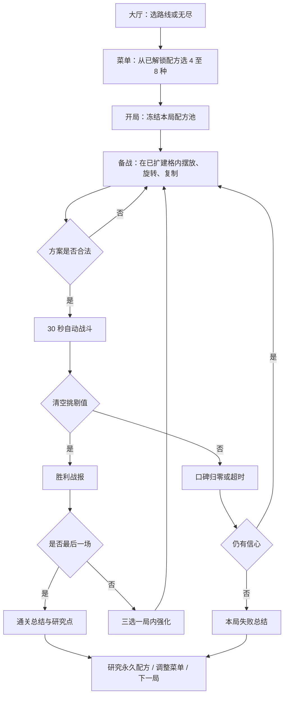

# 《Project Rest Two》当前游戏机制、玩法与规则详解

> 版本快照：2026-08-12 当前工作树  
> 适用入口：`project.godot` 的 `run/main_scene="res://scenes/challenge/challenge_main.tscn"`  
> 文档性质：以当前场景、运行时代码、JSON 配置和核心自检为依据的“已实现规则说明”，不是未来设计提案。

## Executive Summary

- **当前默认游戏是“甜点橱窗构筑挑战”，不是旧版邻里甜点经营模拟。** 玩家先在永久层管理研究、菜单、路线与棋盘扩建，再在单局中用有限备货预算把配方拼入橱窗；开战后配方自动出售，玩家通过战前构筑同时压低 Boss 挑剔值并守住需求窗口造成的口碑压力。
- **核心决策发生在开战前和关卡之间。** 战斗中没有主动技能或临时操作，只有暂停；真正的玩法是菜单取舍、形状拼装、复制数量、售卖周期、库存、满足力、标签覆盖、正交相邻联动，以及胜利后从三选一强化中决定是否重排。
- **标准模式是 5 场短链，失败消耗“信心”，胜利后获得局内强化；完成任一标准路线后开放无尽。** 三条路线按顺序解锁，每条均为 3 场普通、1 场精英、1 场最终 Boss。无尽按层提高挑剔、需求目标与失败伤害，并压低备货预算。
- **长期成长以“解锁更多构筑选项”为主，而不是永久加数值。** 当前有 166 个挑战配方、65 个研究节点、8 条研究分支、21 个局内强化、16 个机制标签和 8 个构筑角色。研究只永久解锁配方；局内强化每局清空。
- **工程合同已通过本次 9 项核心自动化自检，但产品体验仍未验收。** 当前六人产品门为 `PENDING (0/6)`，首批配方差异化真人门为 `PENDING (0/8)`；所以可以确认规则已实现，不能据此断言构筑好懂、配方差异足够或长期节奏合理。

## 1. 范围与事实边界

### 1.1 当前默认可玩入口

项目启动后进入 `ChallengeMain`，它包含以下固定页面：

1. 挑战大厅；
2. 菜单管理；
3. 研究树；
4. 备战与橱窗拼装；
5. 自动战斗；
6. 战报/结算弹窗；
7. 三选一强化；
8. 单局总结。

这些页面由 `scenes/challenge/challenge_main.tscn` 组合，`challenge_main_view.gd` 负责状态路由、绑定、保存和信号转接。

### 1.2 仓库里还有什么，但不属于当前主循环

仓库仍保留 `scenes/Main.tscn` 以及采购、产地、加工、制作、旧橱窗经营、自动化、任务、等级、设备成长等旧系统。它们是历史经营玩法的完整实现或素材来源，但 **不在当前 `run/main_scene` 上**。

因此，本说明把当前产品定义为“独立挑战备货的橱窗构筑 Roguelite”。旧经营仓库、采购库存和制作队列不会被挑战模式消耗，也不会给挑战模式提供资源优势。

## 2. 一局游戏的完整循环



核心循环可压缩成一句话：

> **用有限菜单定义可能性，用空间与预算把可能性变成一个自动销售引擎，再根据战报与强化重构它。**

## 3. 永久层：研究、菜单、路线、扩建与记录

### 3.1 配方收藏与菜单

挑战配置共有 **166 个配方**：

- 初始配方：6 个；
- 研究解锁配方：160 个；
- 菜单下限：4 种不同配方；
- 菜单上限：8 种不同配方；
- 菜单预设：最多保存 3 套；
- 菜单不能包含重复、未解锁或未知配方。

开局时，当前菜单会被复制为本局的 `permanent_pool_snapshot`。这意味着：

- 本局中途解锁的新配方不会自动加入当前局；
- 研究后还必须把配方加入菜单；
- 新菜单只对下一局生效；
- 当前局的强化只修改这份冻结快照，不会永久改写配方配置。

初始 6 个配方如下：

| 配方 | 占格 | 备货成本 | 复制上限 | 每份初始库存 | 售卖周期 | 单次满足力 | 标签 / 角色 |
| --- | ---: | ---: | ---: | ---: | ---: | ---: | --- |
| 黄油曲奇 | 1 | 2 | 3 | 6 | 4 秒 | 4 | 快速、烘焙 / 节奏 |
| 草莓果冻 | 1 | 2 | 3 | 5 | 5 秒 | 5 | 快速、水果 / 节奏 |
| 牛奶布丁 | 2 | 3 | 2 | 4 | 5 秒 | 7 | 饮品、套装 / 搭配 |
| 蓝莓松饼 | 2 | 3 | 2 | 5 | 6 秒 | 8 | 烘焙、套装 / 搭配 |
| 海绵蛋糕 | 4 | 5 | 1 | 3 | 8 秒 | 22 | 招牌、烘焙 / 招牌 |
| 巧克力熔岩蛋糕 | 4 | 5 | 1 | 3 | 10 秒 | 29 | 招牌、巧克力 / 招牌 |

这组初始牌已经覆盖三种基本构筑方向：

- 高频小件：更容易过早期出餐次数窗口；
- 中型搭配件：通过标签与相邻关系获取额外价值；
- 大型招牌件：单次满足力高，但占格、成本和周期压力都更大。

### 3.2 研究树

研究树包含 **65 个节点、8 条分支、160 个配方解锁**。当前节点只发放 `recipe` 类型解锁；存档虽预留 `variant` 与 `upgrade` 字段，但当前配置没有对应奖励。

| 研究分支 | 节点数 | 解锁配方数 | 分支总成本 | 最高层级 |
| --- | ---: | ---: | ---: | ---: |
| 节奏陈列 | 2 | 2 | 10 | T2 |
| 水果套装 | 14 | 34 | 88 | T4 |
| 招牌展示 | 9 | 18 | 59 | T4 |
| 奶香软糯 | 12 | 32 | 74 | T4 |
| 茶香苦甜 | 8 | 24 | 64 | T4 |
| 香脆烘焙 | 5 | 11 | 37 | T4 |
| 咸香饱腹 | 10 | 29 | 72 | T4 |
| 空间联动 | 5 | 10 | 25 | T3 |

节点成本分布：

- T1：8 个节点，每个 3 点；
- T2：11 个节点每个 5 点，另有 3 个节点每个 7 点；
- T3：29 个节点，每个 7 点；
- T4：14 个节点，每个 9 点。

研究规则：

1. 节点必须先被“揭示”；
2. 前置节点必须已经解锁；
3. 研究点必须足够；
4. 支付成本后，节点永久解锁其配方；
5. 同分支中直接以该节点为前置的后继节点会被揭示；
6. Boss 首次击败会揭示指定分支入口或早期节点；
7. 部分最深节点由精通条件额外揭示。

标准路线完整通关发放 **3 点研究点**。无尽每清除 5 层发 1 点，单局最多 3 点，即达到 5/10/15 层时分别结算 1/2/3 点，之后不再增加。

研究树总支付成本是 **429 点**。如果只按每次标准完整通关 3 点换算，理论最低为 **143 次完整通关**；无尽单局收益上限同样是 3 点。这个数字是当前配置的客观经济规模，不等同于“已经证明节奏过慢”，但它明确说明全收集是超长期目标。

### 3.3 路线解锁

当前有三条标准路线，顺序解锁：

1. `standard_short_chain`：五场标准短链，初始开放；
2. `flavor_texture_route`：风味与质地路线，首次完成标准短链后开放；
3. `grand_composition_route`：复合经营路线，首次完成风味与质地路线后开放。

路线首次通关永久记录，不要求以后重复通关才能继续进入后续路线。

### 3.4 精通

当前有 4 个精通条件：

- 首次完成五场标准短链；
- 首次完成风味与质地路线；
- 三条标准路线都至少完成一次；
- 无尽最高纪录达到 20 层。

前两个主要是成就记录；“三路线完成”和“无尽 20 层”还会揭示少量深层研究节点。精通本身不直接增加战斗数值。

### 3.5 永久棋盘扩建

棋盘预留上限是 **8 行 × 14 列，共 112 格**，但新档只开放中央 **4×4，共 16 格**。

扩建产品按形状售卖：

| 形状 | 新格数 | 价格（扩建券） |
| --- | ---: | ---: |
| 单格 | 1 | 1 |
| 2 格长条 | 2 | 2 |
| 3 格长条 | 3 | 3 |
| L 形 3 格 | 3 | 3 |
| L 形 4 格 | 4 | 4 |
| 2×2 方形 | 4 | 4 |

扩建必须满足：

- 不超出 8×14 预留边界；
- 不与已开放格重叠；
- 至少有一个新格与现有棋盘上下左右相连；
- 扩建券足够；
- 只能在备战阶段购买。

扩建券只在 **不同精英或最终 Boss 的首次击败** 时发放，每个 encounter ID 只发一次。当前三条路线共有 3 个精英和 3 个最终 Boss，因此现有内容的自然券源上限是 **6 张**；无尽会复用第一路线的精英/Boss ID，不会重复产券。

所以，当前正常进程最多把永久可用格从 16 增至 **22 格**。8×14 是系统容量上限，不是当前经济能完全填满的实际进度上限。

## 4. 配方卡的完整属性模型

每个挑战配方由以下可玩字段定义：

| 字段 | 作用 | 当前范围 |
| --- | --- | --- |
| `shape_cells` | 配方在棋盘占据的格形 | 1–4 格 |
| `rotatable` | 是否允许以 90° 为单位旋转 | 布尔值 |
| `supply_cost` | 每摆放一份消耗的备货点 | 2–6 |
| `copy_limit` | 同一配方本场最多摆放份数 | 1–3 |
| `virtual_stock` | 每个实例本场可自动售出的份数 | 2–6 |
| `cycle_ms` | 每次自动售卖的间隔 | 2–10 秒 |
| `satisfaction` | 每次售卖造成的基础满足力 | 4–29 |
| `tags` | 需求检查、联动与强化的语义接口 | 16 种 |
| `build_roles` | 菜单分析与玩家理解用的构筑角色 | 8 种 |

166 个配方的形状分布为：

- 1 格：26 个；
- 2 格：94 个；
- 3 格：25 个；
- 4 格：21 个。

复制上限分布为：

- 上限 1：44 个；
- 上限 2：96 个；
- 上限 3：26 个。

这说明当前配方池的主体不是“一格数值卡”，而是需要考虑朝向、占位和相邻面的 2 格配方。

## 5. 备战规则：橱窗拼装与合法性

玩家从本局冻结菜单中拖入配方实例，并为每份实例确定位置和旋转。

合法方案必须同时满足：

1. 每个实例有唯一 `instance_id`；
2. 配方存在于本局冻结池；
3. 同配方份数不超过 `copy_limit`；
4. 所有实例的 `supply_cost` 总和不超过本场备货预算；
5. 所有占格在 8×14 边界内；
6. 所有占格属于已经永久扩建的格子；
7. 不同实例不能重叠；
8. 不可旋转配方只能使用 0°；可旋转配方只能使用 90° 的整数倍。

方案不合法时，开战被阻止，并返回第一条可操作错误，例如“备货点不足”“目标格未扩建”“配方达到摆放上限”。

一个反直觉边界：领域服务没有要求“至少摆 1 份”。空方案在结构上可以合法开战，但没有任何售卖能力，通常会因需求失败、口碑归零或 30 秒超时而败北。

## 6. 相邻联动规则

每场 encounter 定义一组标签关系，例如：

- 水果 + 烘焙；
- 饮品 + 烘焙；
- 招牌 + 快速。

若一个带左标签的配方实例与一个带右标签的实例 **上下左右正交相邻**，就生成一条有效联动。斜角接触不算。

联动对售卖的影响：

```text
联动加成 = 基础满足力 × 联动百分比 ÷ 100（整数截断）
最终满足力 = 基础满足力 + 联动加成
```

例如基础满足力 8、联动 25% 时，加成 2，最终为 10；基础满足力 4、联动 15% 时，整数截断后加成可能为 0。

当前实现还有两条重要细则：

- 同一实例连出多条关系时，售卖加成取该实例关联关系中的 **最大百分比**，不会把多条邻接加成累加；
- `active_relation_count` 需求按关系边数量计数，所以多组有效邻接仍然有助于通过“有效联动数量”窗口。

因此，“多连边”对需求窗口和“单次售卖伤害”的价值不同：前者可累计关系数，后者不累计百分比。

## 7. 自动战斗：时间、售卖、双压力与胜负

### 7.1 战斗不是实时操作，而是战前方案的确定性演算

开战后：

- 每个配方实例独立计时；
- 到达 `cycle_ms` 时自动售出 1 份；
- 每次售卖减少 1 点该实例库存；
- 只要还有库存，就把下一次售卖时间推进一个周期；
- 库存为 0 后，该实例停止售卖；
- 玩家可以暂停或继续，但不能在战斗中改位置、换配方或释放主动技能。

当前 15 个标准 encounter 都是 **30 秒**。

### 7.2 Boss 挑剔值：进攻目标

每次售卖的最终满足力会减少 Boss 挑剔值：

```text
实际减少量 = min(本次最终满足力, 当前剩余挑剔值)
```

挑剔值降到 0 时立即胜利。多余满足力只记录为溢出，不转化为其他资源。

### 7.3 口碑值：防守目标

战斗从 100 口碑开始。每场有 3 个定时需求窗口；到点时检查指定指标：

- 达标：不扣口碑；
- 未达标：一次性扣除该窗口配置的口碑伤害；
- 口碑降到 0：立即以 `loss_reputation` 失败。

当前配置实际使用 4 类指标：

- `sales_count`：截至该时刻的累计售卖次数；
- `active_relation_count`：开战快照中的有效联动边数量；
- `window_satisfaction`：指定时间区间内售卖产生的满足力总和；
- `tag_sales_count`：带指定标签的售卖次数。

战斗引擎还支持 `tag_satisfaction` 和 `distinct_tag_count`，但当前 15 个 encounter 没有使用它们。

### 7.4 同时刻事件顺序

同一毫秒发生多个事件时：

1. 先按实例 ID 排序处理所有到点售卖；
2. 如果售卖已经把挑剔值清零，立即胜利；
3. 否则再检查该时刻的需求窗口；
4. 若口碑归零，立即失败；
5. 到达 30 秒且仍未胜利，则 `loss_timeout`。

因此，在需求检查点同一时刻发生的售卖会计入该窗口；在 30 秒整发生的最后一次售卖也有机会先完成击杀。

### 7.5 三种战斗结果

- `victory`：挑剔值归零；
- `loss_reputation`：需求失败使口碑归零；
- `loss_timeout`：时间结束仍有挑剔值。

胜利发生后，未到时间的需求窗口不再检查。

## 8. 战报与失败反馈

战报保存并展示：

- 战斗结果和结束时间；
- 剩余挑剔值、剩余口碑；
- 每个需求窗口的目标、实际值、是否通过和口碑损失；
- 每个配方的售卖次数、基础满足力、联动加成、总满足力；
- 已生效强化；
- 主要失败窗口；
- 针对失败指标的建议。

建议是规则映射，不是 AI 猜测。例如：

- 售卖次数不足 → 增加短周期配方或前段备货；
- 有效联动不足 → 让目标标签配方正交相邻；
- 区间满足力不足 → 增加中后段满足力或避免关键配方提前售罄；
- 标签售卖不足 → 增加目标标签配方并保证在截止前出餐。

## 9. 信心、失败与重试

标准局和无尽局都从 **2 点信心**开始。

标准模式：

- 每次战斗失败扣 1 点信心；
- 仍有信心时，可回到同一场重新备战；
- 信心归零时整局失败；
- 标准模式没有场间自然恢复信心；
- 胜利不会消耗信心。

无尽模式：

- 失败同样扣 1 点；
- 每清除 5 层触发一次恢复节点，恢复 1 点，最多回到 2；
- 信心归零时结束本次无尽并结算最高层。

## 10. 局内强化：胜利后的三选一

除最终场外，每次胜利后都会生成 **3 个候选强化**。当前强化池共有 21 个：

- 兼容型：15 个；
- 通用型：4 个；
- 转向型：2 个。

生成规则：

1. 第一项优先匹配当前摆放中实际使用的配方或标签；没有兼容项时用通用项兜底；
2. 第二项固定从通用池选择；
3. 第三项从剩余兼容、通用和可用转向项中选择；
4. 一次报价最多出现 1 个转向型；
5. 已到叠加上限或与现有强化互斥的项不会进入候选；
6. 候选由 run ID、阶段、奖励种子、当前配方与标签构成的签名确定，可复现而非任意漂移。

强化效果覆盖 9 种类型：

- 增加备货预算；
- 增加复制上限；
- 缩短售卖周期；
- 增加满足力；
- 增加虚拟库存；
- 增加联动百分比；
- 添加标签；
- 改变配方形状/旋转能力；
- 为首个需求窗口提供口碑伤害缓冲。

强化可以叠加，但受各自 `max_stacks` 限制；互斥组只能保留一个方向。形状、复制、预算、周期、标签和联动改变可能使上一场的合法摆法不再合适，因此系统会提示“需要重排”。

所有强化只属于当前 run，新开标准局或无尽局时都会从空强化列表开始。

## 11. 三条标准路线的关卡规则

每条路线固定 5 场，结构都是：普通、普通、普通、精英、最终 Boss。

### 11.1 五场标准短链

| 场次 | Encounter | 预算 | 挑剔 | 联动 | 三个需求窗口 |
| --- | --- | ---: | ---: | --- | --- |
| 1 | 晨间赶潮 | 16 | 112 | 水果+烘焙 15% | 8/16/24 秒累计售卖 ≥ 8/16/28 |
| 2 | 搭配品鉴会 | 16 | 138 | 饮品+烘焙 25% | 12 秒联动 ≥1；8–20 秒满足力 ≥58；26 秒累计售卖 ≥10 |
| 3 | 午后连浪 | 15 | 194 | 水果+烘焙 20% | 10 秒售卖 ≥6；8–20 秒满足力 ≥72；20–28 秒满足力 ≥35 |
| 4 | 周末招牌日（精英） | 12 | 188 | 招牌+快速 25% | 8 秒售卖 ≥3；16 秒联动 ≥1；16–28 秒满足力 ≥62 |
| 5 | 挑剔美食评论家（Boss） | 16 | 197 | 饮品+烘焙 25% | 8 秒售卖 ≥3；16 秒联动 ≥1；16–24 秒满足力 ≥74 |

### 11.2 风味与质地路线

| 场次 | Encounter | 预算 | 挑剔 | 联动 | 关键标签要求 |
| --- | --- | ---: | ---: | --- | --- |
| 1 | 柔软晨间席 | 16 | 112 | 水果+烘焙 20% | 8 秒前至少售出 1 次饮品 |
| 2 | 茶香品鉴厅 | 16 | 138 | 饮品+烘焙 23% | 12 秒前至少售出 1 次招牌 |
| 3 | 香脆烘焙节 | 15 | 194 | 水果+烘焙 26% | 10 秒前至少售出 1 次烘焙 |
| 4 | 质地校准师（精英） | 12 | 188 | 招牌+快速 29% | 8 秒前至少售出 1 次饮品；16 秒联动 ≥1 |
| 5 | 风味甜点考核（Boss） | 16 | 197 | 饮品+烘焙 32% | 8 秒前至少售出 1 次招牌；16 秒联动 ≥1 |

其余中后段满足力和累计售卖目标沿用对应阶段的短链骨架。

### 11.3 复合经营路线

| 场次 | Encounter | 预算 | 挑剔 | 联动 | 关键标签要求 |
| --- | --- | ---: | ---: | --- | --- |
| 1 | 饱腹市集 | 16 | 112 | 水果+烘焙 20% | 8 秒前至少售出 1 次快速 |
| 2 | 橱窗建筑师 | 16 | 138 | 饮品+烘焙 23% | 12 秒前至少售出 1 次套装 |
| 3 | 咸甜宴会 | 15 | 194 | 水果+烘焙 26% | 10 秒前至少售出 1 次招牌 |
| 4 | 复合构筑总监（精英） | 12 | 188 | 招牌+快速 29% | 8 秒前至少售出 1 次套装；16 秒联动 ≥1 |
| 5 | 终局陈列评论家（Boss） | 16 | 197 | 饮品+烘焙 32% | 8 秒前至少售出 1 次招牌；16 秒联动 ≥1 |

这两条后续路线没有改变战斗底层，而是通过更严格的标签门槛和更高联动百分比，迫使玩家改变菜单组成。

## 12. 无尽爬升

无尽在首次完成任一标准 run 后开放。它使用玩家当前菜单构成的永久配方池，但不会继承上一局强化。

### 12.1 层级类型

- 普通层按“晨间赶潮 → 搭配品鉴会 → 午后连浪”循环；
- 每 5 层为精英层；
- 每 10 层为最终 Boss 层，Boss 优先于精英判定。

因此第 5、15、25…层是精英，第 10、20、30…层是 Boss。

### 12.2 难度增长

以第 1 层为索引起点，每提高一层：

- 挑剔值增加 8；
- 非“有效联动数量”的需求目标增长 2%，最多增长到基础值的 150%；
- 每 4 个压力级，备货预算减少 1，最低为 10；
- 每 5 层进入一个伤害 tier，所有失败窗口伤害再增加 2。

“有效联动数量”目标不随层数增长，避免把空间关系要求无限放大。

### 12.3 无尽奖励与记录

- 每胜一层仍获得一次三选一局内强化；
- 每 5 层恢复 1 信心，最多 2；
- 每 5 个胜利层折算 1 研究点；
- 单局研究点最多 3；
- 失败结束时保存最高层、最终强化、最后橱窗快照和关键战报；
- 永久记录保存总局数、上次快照和最佳快照。

## 13. 存档、恢复与幂等规则

挑战存档与旧项目存档分离，路径为：

```text
user://project_rest_two_save_v1.json
```

关键规则：

- Schema 版本固定为 1；
- 保存采用“临时文件 → 旧档备份 → 提升临时文件”的替换流程；
- 当前存档损坏时会先保存 `.broken`，再尝试恢复 `.previous`；
- 战斗进行中每跨过一个新的整秒就保存一次；
- 配方摆法变化、强化选择、研究、扩建、结算等状态转换都会提交存档；
- 战斗尝试、结算、研究奖励、强化奖励和扩建券都有事务 ID 或首次领取 ID，防止重复结算；
- 启动时会根据 `active_run.phase` 恢复到备战、战斗、战报、强化或总结页面。

若存档缺少当前版本所需的永久扩建状态，引导迁移会清除正在进行的 run/battle，以避免旧布局落到新棋盘规则后产生非法状态。

## 14. 新手引导

新档引导状态为版本 2，从 Boss 简报开始。引导覆盖：

- 认识 Boss 与需求；
- 进入备战；
- 摆放配方；
- 旋转或调整；
- 开始自动战斗；
- 阅读战报；
- 失败后的重排；
- 胜利后的强化；
- 完成后的研究与下局菜单。

引导状态持久化，可关闭，也可从顶部问号重新打开。阶段二提示按功能页出现一次，避免每次打开页面重复阻塞。

## 15. 玩家真正需要权衡的六组矛盾

### 15.1 周期 vs. 单次满足力

短周期配方能快速累计售卖次数，也更容易在早期窗口前出餐；高满足力配方擅长清空挑剔值和冲击区间满足力，但如果周期过长，可能来不及通过标签或次数门槛。

### 15.2 库存 vs. 战斗时长

高频配方不一定能持续 30 秒。库存售罄后停止出餐，所以要区分“开场爆发”和“中后段续航”。

### 15.3 占格 vs. 输出密度

大配方可能单次效果高，但会减少可放实例数、可用邻接面和形状组合；小配方更灵活，却受复制上限和备货预算约束。

### 15.4 标签覆盖 vs. 数值效率

后续路线会直接检查特定标签是否在截止前实际售出。只按满足力排序的菜单可能总输出高，却因缺少标签窗口而被扣光口碑。

### 15.5 联动边数 vs. 单实例加成

多连边能提高 `active_relation_count`，但同一实例的售卖联动百分比不叠加。因此，为了过关系数量窗口而做的布局，不一定也是最高伤害布局。

### 15.6 当前兼容强化 vs. 转向强化

兼容型强化放大已有阵容，稳定；转向型强化要求启用已解锁但当前未上阵的配方，可能打开新构筑，也可能迫使整个橱窗重排。

## 16. 容易误解但已经确认的规则

1. **战斗中不能手动卖货。** 全部出售由周期自动触发。
2. **挑战不消耗旧经营库存。** `virtual_stock` 是每个摆放实例独立的挑战备货。
3. **菜单不是摆放上限。** 菜单限制“配方种类”，每种还能按 `copy_limit` 放多份。
4. **扩建格不增加备货预算。** 它只增加可用空间。
5. **联动只看正交接触。** 对角线不算。
6. **联动百分比不多边叠加。** 同一实例取最大值。
7. **早胜可以跳过后续需求。** 挑剔值清零后立即结束。
8. **研究解锁不在当前 run 即时生效。** 还需加入菜单并新开局。
9. **路线和无尽解锁是永久元进度。** 局内强化不是。
10. **当前引擎能力大于现有内容使用面。** `tag_satisfaction`、`distinct_tag_count`、variant/upgrade 研究奖励和完整 8×14 扩建容量都已预留，但现有配置没有完全使用。

## 17. 当前内容规模与进度经济

| 指标 | 当前值 | 含义 |
| --- | ---: | --- |
| 挑战配方 | 166 | 6 初始 + 160 研究 |
| 研究节点 | 65 | 8 分支 |
| 研究总成本 | 429 | 标准完整通关每次 3 点 |
| 标准路线 | 3 | 顺序解锁 |
| 标准 encounter | 15 | 每路线 5 场 |
| 局内强化 | 21 | 15 兼容、4 通用、2 转向 |
| 标签 | 16 | 战斗、关系与强化接口 |
| 构筑角色 | 8 | 菜单理解与路线推荐 |
| 棋盘容量 | 112 | 8×14 系统上限 |
| 初始开放格 | 16 | 中央 4×4 |
| 当前自然可达开放格 | 22 | 由 6 个首次精英/Boss 券源推导 |
| 标准初始信心 | 2 | 失败一次仍可重试 |
| 无尽研究收益 | 每 5 层 1 点，最多 3 | 防止无尽成为无限养成源 |

## 18. 已验证、合理推测与尚未验证

### 已确认的事实

- 当前主场景、页面路由和存档恢复路径；
- 菜单、拼装、战斗、需求窗口、胜负、信心、强化、研究、路线、无尽和扩建规则；
- JSON 配置中的数量、成本、目标、周期和奖励；
- 本次 9 个核心 Godot 头部自检通过；
- 六人产品门与八局配方差异化门仍为 `PENDING`。

### 合理推测/设计解释

- 玩法意图是用“空间拼装 + 时间窗口 + 标签覆盖”阻止玩家只按单一满足力排序；
- 后续路线通过标签门槛引导玩家更换菜单，而非只让敌人血量上涨；
- 无尽收益封顶是为了保持标准路线和研究规划的价值。

这些解释与配置和代码结构一致，但不是玩家研究结论。

### 暂时无法确认

- 新玩家能否在两分钟内识别两条以上构筑方向；
- 166 个配方在人类体验中是否真的有足够差异；
- 429 点研究成本是否形成合理长期节奏，还是过度重复；
- 是否存在跨三条路线都占优的统治菜单；
- 无尽中玩家是否会主动改变构筑，而不是只堆叠数值；
- 实际鼠标手感、信息密度、1920×1080 以外分辨率和长时间体验是否合格。

## 19. 当前最值得继续验证的问题

1. **研究节奏是否过长。** 429 点总成本与单局最多 3 点之间的比例需要真人留存与重复游玩证据，而不能只凭自动化判断。
2. **配方差异是否可感知。** 属性有差异不等于玩家能理解差异；当前 0/8 的差异化试玩门必须补齐。
3. **路线是否真正迫使换菜单。** 需要观察玩家是否因标签窗口和空间关系调整菜单，而不是沿用一个高满足力模板。
4. **扩建经济是否符合预期。** 系统上限 112 格，而当前自然进程最多 22 格；应确认这是“有限塑形”还是尚缺奖励源。
5. **无尽是否产生构筑转折。** 难度目前主要通过挑剔、目标、预算和伤害递增；需要真人记录证明强化与重排能产生非纯数值的后期变化。
6. **旧经营系统的产品定位。** 旧系统仍大量存在但不在默认入口，应明确它是素材库、未来元层，还是准备移除的历史实现。

## 20. 验证记录与来源

本说明交叉读取了：

- `project.godot` 与 `scenes/challenge/challenge_main.tscn`；
- `scripts/challenge/challenge_main_view.gd`；
- `challenge_session_service.gd`、`challenge_run_service.gd`、`challenge_loadout_service.gd`；
- `boss_battle_service.gd`、`boss_battle_report_service.gd`；
- `run_upgrade_service.gd`、`recipe_research_service.gd`、`endless_climb_service.gd`；
- `challenge_route_service.gd`、`challenge_mastery_service.gd`；
- `challenge_board_expansion_service.gd`、`challenge_save_service.gd`；
- `doc/challenge/*.json` 的路线、遭遇、配方、研究、强化、精通和无尽配置；
- `doc/challenge/stage11_product_gate.md` 与配方差异化试玩门。

本次运行并通过的核心自检：

1. `challenge_loadout_service_self_check.gd`；
2. `boss_battle_service_self_check.gd`；
3. `challenge_standard_run_service_self_check.gd`；
4. `recipe_research_service_self_check.gd`；
5. `run_upgrade_service_self_check.gd`；
6. `challenge_board_expansion_service_self_check.gd`；
7. `endless_climb_service_self_check.gd`（覆盖 200 层生成）；
8. `challenge_save_service_self_check.gd`；
9. `challenge_main_scene_self_check.gd`。

Godot 在每次头部进程退出时报告“无法读取 Windows 根证书存储”，但 9 个目标自检均在该信息之前明确输出 PASS，且退出码为 0。该证书信息与本地离线机制测试无关。
